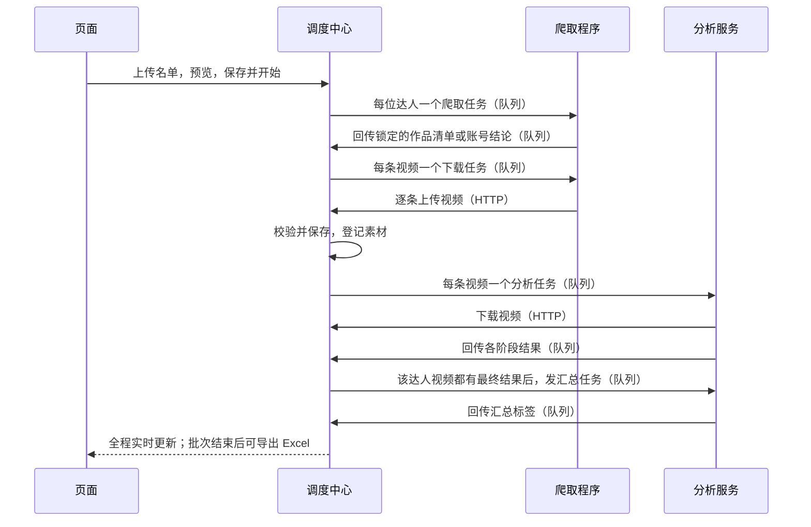

# 调度中心设计方案

更新日期：2026-11-17  
状态：第一期已实现，并与模拟爬取程序、分析服务联调。第 13 节的问题未答复的部分按其中的默认做法实现。

与分析服务的接口约定见[视频分析服务设计](https://github.com/sunluojia/video-analysis-service/blob/main/docs/architecture.md)第 3 节。本文介绍调度中心自身的设计和它与爬取程序的约定。

**全新设计。** 旧系统（video-insight-pipeline）只用来确认业务需求：输入名单的格式、交付表格的格式和业务规则。它的代码、表结构、状态机和调度方式都不沿用，也不参考。

## 1. 三个程序，各管一段

| 程序 | 负责 | 不负责 |
| --- | --- | --- |
| 调度中心（本项目） | 批次、名单、业务规则和结论；发布爬取、下载和分析任务，接收结果；保存原视频供分析服务下载；集中管理代理并按用途分配线路；页面和 Excel 导出 | 不爬取、不下载视频、不做分析 |
| 爬取程序 | 爬取任务：打开达人主页，按任务里的规则锁定最新作品；下载任务：下载一条视频并上传给调度中心 | 不判断业务结论，不决定下载哪些作品，不保存业务状态 |
| 视频分析服务 | 下载视频，抽帧、听音、识别、作者汇总 | 不管批次和达人的业务流程 |

调度中心对爬取程序和分析服务用同一种方式：**任务经 Redis 队列发布，结果经 Redis 队列回传，文件经 HTTP 传输，控制和查询经 HTTP 接口**。两个执行程序都向调度中心注册并保持心跳，各自控制自己的并发；调度中心只负责发布，不限制提交数量。唯一的例外是代理：爬取程序可以多实例组成集群，代理是整个集群共用的资源，由调度中心集中维护一个通用代理池。代理按用途（获取信息、下载视频，以后其他模块也一样）分配，每个用途有集群设置和设备例外，爬取程序每做一次任务前按用途申请线路，见[代理方案](proxy-design.md)。

## 2. 第一期做什么

| 范围 | 第一期 | 第二期 |
| --- | --- | --- |
| 批次与名单 | 上传 Excel 或粘贴链接建批次，预览后保存、开始、暂停、继续、取消、删除 | — |
| 爬取与下载 | 按第 4 节的约定发布爬取任务和下载任务、接收结果和视频；提供一个模拟爬取程序，从本地目录读取作品和视频，只用于开发和联调 | 真实的爬取程序按约定实现（不在本项目内） |
| 原视频 | 接收上传，校验大小和 SHA-256 后保存；提供下载接口；分析完成后清理 | 需要时换对象存储 |
| 分析 | 推送单视频分析和作者汇总任务，接收并保存各阶段事件，补跑、重新分析、放弃 | — |
| 执行程序 | 爬取程序和分析服务的注册、心跳、在线状态；控制、AI 配置和运行状态经后端转发 | — |
| 页面 | 第 8 节的全部页面，实时更新 | — |
| 导出 | 三张表的 Excel | — |
| 通知 | 页面内的状态和提示 | 飞书通知 |
| 访问 | 内部使用，不设登录；页面用的接口不鉴权，执行程序用的接口（注册心跳、上传视频、下载原视频）要求服务凭据 | — |

## 3. 业务流程



爬取和下载分成两种任务：爬取任务只锁定作品，下载哪些作品由调度中心决定，每条视频单独一个下载任务。一条视频上传完成就提交分析，不等同一达人的其他视频，也不等其他达人。

### 3.1 业务规则（取自现有交付要求）

**由爬取程序执行，规则参数随爬取任务下发：**

- 按发布时间从新到旧取截止时间（批次开始时间）之前的前五条，图文和视频一起计数，置顶不影响排序。
- 账号私密或不存在时，回传对应结论。

**由调度中心根据爬取结果判断：**

- 作品清单回传后锁定，后续下载失败也不用其他作品补位。
- 只为视频作品发布下载任务，图文作品不下载。
- 五条全是图文的标“图文作者”；没有作品的标“无作品”；作品不足五条的，空位注明“作品不足五条（实际 N 条）”。混排的达人，图文作品位置标“图文作者”，视频照常分析。
- 私密账号、找不到此达人，进入“失败账号”表。
- 爬取失败（例如网络或登录问题），进入“重新抓取”表，可以重新爬取。
- 视频下载失败，这条视频算作失败，可以单独重新下载。
- 该达人选定的视频都有了最终结果（完成、失败或已放弃）才发汇总任务。至少一条成功就用成功的视频汇总，并注明覆盖范围；全部失败不调用汇总模型，进入“重新抓取”表。
- 待核查的视频（模型请求发出但结果不明）需要人在页面上选择“补跑”或“放弃”，之后才算有最终结果。

## 4. 与爬取程序的约定

爬取程序按这里的约定实现即可，不需要引入调度中心的代码。与分析服务一样：同一个 Redis 和命名空间、约定的队列名和处理器名、Dramatiq 2.x、相同的服务凭据。

### 4.1 任务

队列 `crawler.tasks`，参数是一个 JSON 对象。两种任务：

| 处理器 | 用途 |
| --- | --- |
| `crawl_creator` | 爬取任务：打开达人主页，锁定最新作品，回传作品清单或账号结论 |
| `download_video` | 下载任务：下载一条视频并上传给调度中心 |

`crawl_creator`：

```json
{
  "task_id": "爬取任务 ID（UUID）",
  "run": 1,
  "batch_id": "批次 ID",
  "creator": {"handle": "达人账号", "oecuid": "creator_oecuid，可能为空"},
  "cutoff": "2026-11-17T08:00:00+08:00",
  "max_works": 5
}
```

`download_video`：

```json
{
  "task_id": "下载任务 ID（UUID）",
  "run": 1,
  "batch_id": "批次 ID",
  "creator": {"handle": "达人账号", "oecuid": "creator_oecuid，可能为空"},
  "work": {"work_id": "平台作品 ID", "url": "作品链接"}
}
```

- 下载任务只带作品链接。平台的媒体地址有时效，由爬取程序下载时重新获取。
- 相同或更小轮次的重复投递直接忽略；重新爬取、重新下载用更大的轮次，爬取程序丢弃上一轮的进度。
- 格式错误的消息进入死信队列。

### 4.2 回传事件

队列 `crawler.events`，处理器 `crawler_event`。每个事件带 `event_id`（调度中心按它去重）、`task_id`、`run`、`type`、`occurred_at`：

| `type` | 适用任务 | 什么时候 | 附带内容 |
| --- | --- | --- | --- |
| `accepted` | 两种 | 受理 | — |
| `crawled` | 爬取任务 | 爬取结束 | 结论：`ok`、`private`、`not_found` 或 `failed`（附原因）；`ok` 时附作品清单：位置、平台作品 ID、链接、类型（video／photo）、发布时间、发布描述、话题，可能少于五条或为空；可选附达人资料 `profile`：账号 `handle`、主页链接 `url`、昵称 `nickname`、平台用户 ID `platform_user_id`（后两项可为空），调度中心保存最近一次并在达人详情显示 |
| `download_failed` | 下载任务 | 经爬取程序自己的重试仍下载失败 | 原因 |

下载成功不另发事件，以上传成功为准（4.3 节）。事件可能乱序到达，调度中心按轮次和状态推进，只前进不后退。

爬取程序只消费 `crawler.tasks`。投递事件时如果在同一个 broker 上声明了 `crawler.events`，启动 Dramatiq Worker 时要限定只消费任务队列（`queues={"crawler.tasks"}`，命令行用 `--queues crawler.tasks`），否则 Worker 会把发给调度中心的事件当作未知处理器移进死信队列。

### 4.3 上传视频

`PUT /api/download-tasks/{task_id}/runs/{run}/video`，请求体是视频文件，请求头带 `Content-Length` 和 `X-Content-SHA256`，使用服务凭据。

- 调度中心边接收边写入临时文件，大小和 SHA-256 一致后保存并登记素材，随即提交分析任务；不一致返回 422，爬取程序重新下载或上传。
- 相同内容重复上传直接返回成功。
- 下载任务不存在时返回 404；已取消、已报告失败、已有更新的轮次，或这一轮已上传过其他内容时返回 409。这两种情况爬取程序都丢弃这个文件，不再重试。
- 上传成功后，爬取程序可以删除本地文件。

### 4.4 注册心跳与爬取程序提供的接口

爬取程序启动后调用调度中心的 `PUT /api/crawler-services/{instance_id}` 注册，之后每 15 秒发送心跳，停止时 `DELETE`。超过 60 秒没有心跳视为离线。心跳包含执行程序的地址 `url`、版本 `version`、正在用的线路（见[代理方案](proxy-design.md)第 3 节）和本机身份池快照（见[爬取方案](crawler-design.md)第 6.3 节）。调度中心回复 `{"identity_target": n, "crawl_slots": 2, "download_slots": 4, "warm_slots": 1}`。`identity_target` 是分到本机的可用身份目标，其余三个值是本机的采集、下载和预热并发，在「执行程序」页设置。爬取程序收到心跳回复后开始任务，之后随心跳应用新配置。分析服务在这些字段中返回 `null`。

爬取程序自己提供以下接口，都要求服务凭据（`Authorization: Bearer <服务凭据>`）：

| 接口 | 用途 |
| --- | --- |
| `POST /api/batches/{batch_id}/pause` | 暂停这个批次：已排队的任务先不执行，正在执行的可以做完 |
| `POST /api/batches/{batch_id}/resume` | 继续这个批次 |
| `POST /api/batches/{batch_id}/cancel` | 取消这个批次：丢弃它的全部任务，不再回传事件 |
| `POST /api/tasks/{task_id}/cancel` | 取消一个任务 |
| `GET /api/status` | 运行状态，“执行程序”页显示：`crawl`、`download` 各是 `{"running": 进行中, "queued": 还没开始的}`；`identities` 是 `{"target": 分到的, "ready": 可用的}`，没有身份池时为 `null`；`leases` 正在用的线路数；`paused_batches` 暂停的批次 ID；`download_paused_until` 下载连续失败时设备暂停到的时间，没暂停为 `null` |
| `GET /api/crawl-progress` | 正在采集的达人任务，包含 `task_id`、`handle`、`stage`（`waiting_line`、`profile`、`listing`）、已读页数 `pages_read`、候选作品数 `works_found` 和作品上限 `max_works`。候选按作品 ID 去重、按截止时间筛选，计数最多到作品上限。调度中心汇总在线设备，供「执行程序」显示达人信息获取和视频列表获取进度。 |
| `GET /api/download-progress` | 当前下载列表，包含 `task_id`、平台 `work_id`、阶段 `stage`（`preparing`、`downloading` 或 `uploading`）、已下载 `received_bytes` 和总大小 `total_bytes`。总大小未知时为 `null`。响应头 `X-Download-Bytes-Per-Second` 表示本机最近 5 秒接收视频数据的平均速率。调度中心查询在线爬取设备，页面每 2 秒更新进度和合计速度。 |

调度中心在暂停、继续、取消批次时先提交自己的状态，再通知各个在线的执行程序；通知失败只在页面上提示，不回滚。取消时发件箱里该批次还没投递的任务一并撤回。取消锁住批次后，正在处理的事件照常提交：行锁用 `FOR NO KEY UPDATE`，与外键检查兼容。即使没有收到通知，已取消批次的事件和上传也会被调度中心忽略或拒绝。

## 5. 原视频存储与下载

- 爬取程序上传的视频保存到 `data/materials/<素材 ID>`，登记大小和 SHA-256。
- 分析服务的下载接口 `GET /api/materials/{id}` 使用服务凭据鉴权，由框架的文件响应直接支持 `Range` 断点续传，不自己实现。
- 视频的分析任务完成或放弃后删除原视频；失败、待核查的继续保留，供补跑使用。取消或删除批次时一并清理。Worker 定期删除没有登记、或已标记清理的文件（留 10 分钟余量，避开正在上传的文件）。
- 抽帧图片和音频段留在分析服务，页面需要时经后端转发获取。

## 6. 数据模型

调度中心保存业务状态和最终交付结果；执行程序内部的进度、租约和额度不在这里保存，只保存它们回传的事件和结果。

| 表 | 主要内容 |
| --- | --- |
| `batches` 批次 | 名称、状态、截止时间、创建／开始／结束时间、来源文件名 |
| `creators` 达人 | 所属批次、名单中的行号、达人账号、creator_oecuid、二维码图片、状态、结论和原因、文字去重标签、AI 汇总标签、爬取程序回传的平台资料、最近活动时间 |
| `crawler_tasks` 爬取程序的任务 | 任务 ID、类型（爬取／下载）、对应达人或作品、轮次、状态、结论和原因、受理／结束时间 |
| `works` 作品 | 所属达人和爬取轮次、位置（1～5）、平台作品 ID、链接、类型、发布时间、发布描述、话题、素材 |
| `materials` 素材 | 文件位置、大小、SHA-256、登记时间、清理时间 |
| `analysis_jobs` 分析任务 | 任务 ID、类型（单视频／汇总）、对应作品或达人、轮次、状态、结果、错误、复用来源、产物保留期限 |
| `analysis_stages` 分析阶段 | 任务、轮次、阶段、片段号、状态、尝试次数、结果、模型和提示词版本、错误、时间、下次重试时间 |
| `events` 事件 | 来源（爬取／分析）、事件 ID（去重）、自增序号（排序用）、任务、轮次、原始内容、发生和接收时间 |
| `executors` 执行程序 | 类型（爬取／分析）、实例标识、访问地址、版本、最近心跳、注册和注销时间 |
| `outbox` 待发消息 | 要发布的爬取、下载和分析任务，与业务数据同一事务写入 |
| 代理相关表 | 代理（含文件夹和用途）、文件夹、各用途的集群设置和设备例外、各用途的线路使用情况和状态、最近 24 小时的线路表现，见代理方案 |

### 6.1 状态

| 对象 | 状态 |
| --- | --- |
| 批次 | 草稿 → 进行中 ⇄ 已暂停 → 已完成；任何时候可取消 |
| 达人 | 待爬取 → 爬取中 → 分析中 → 汇总中 → 已完成；私密或找不到时为失败；爬取失败或视频全部失败时为需重新抓取 |
| 爬取任务 | 待发布 → 已发布 → 已受理 → 已结束（锁定作品／私密／找不到／失败） |
| 下载任务 | 待发布 → 已发布 → 已受理 → 已上传／失败 |
| 视频分析任务 | 待提交 → 已提交 → 已受理 → 处理中 → 已完成／失败／待核查／已放弃 |

状态都由事件推导并保存，页面直接读取，不在前端拼状态。

## 7. 与分析服务对接

完全按[接口约定](https://github.com/sunluojia/video-analysis-service/blob/main/docs/architecture.md)实现：

| 部件 | 做法 |
| --- | --- |
| 推送任务 | 写入发件箱，由 Worker 投递到 `analysis.tasks`（`analyze_video`、`summarize_creator`）。任务 ID 用 UUID；重新分析时轮次加一并传 `allow_reuse: false` |
| 接收事件 | 消费 `analysis.events` 的 `analysis_event`：按事件 ID 去重保存，更新分析任务和阶段，推进达人和批次，必要时发汇总任务。旧轮次的事件只记入历史 |
| 事件乱序 | 分析任务记下最近一次采用的事件时间，比它早的任务事件只记入历史，也不再改动视频；比较的都是分析服务的时间，不和调度中心的时钟比。重新提交时清空。补跑接口的回执带分析服务的时间（`occurred_at`），和事件一样按先后采纳，晚到的回执不会盖掉补跑之后的结果 |
| 注册与心跳 | `PUT／DELETE /api/analysis-services/{instance_id}`；超过 60 秒没有心跳视为离线，在线状态按读取时的心跳时间计算 |
| 控制与查询 | 补跑、取消、暂停批次，以及任务详情、AI 配置、运行状态，都由后端用 HTTPX 带服务凭据转发到已注册的地址；浏览器不直接访问执行程序 |
| 对账 | Worker 定期检查发布 30 分钟后仍未受理的爬取、下载和分析任务，在对应执行程序在线时按原内容重新投递（对方按任务 ID 和轮次去重） |

## 8. 页面

| 页面 | 显示什么 | 主要操作 |
| --- | --- | --- |
| 批次工作台（首页） | 左侧批次列表：名称、状态、达人进度条、达人和视频完成数、需要处理的数量。右侧选中的批次：达人状态带（待爬取 → 爬取中 → 下载中 → 音频分析中 → 视频分析中 → 汇总中 → 已完成／失败账号／需要重新抓取／无法识别）和视频状态；达人表每行带五个作品格，展开后逐条看作品的状态、标签、失败原因和发布描述；“问题视频”页签集中列出失败和待核查的视频 | 新建；按名称和状态筛选批次；点状态带筛选达人；暂停、继续、补跑失败、重新抓取、取消、删除、导出 Excel |
| 新建批次 | 上传 Excel 或粘贴链接，预览解析出的达人和问题行 | 保存，或保存并开始 |
| 达人详情 | 爬取记录；选定的五条作品及状态和标签；汇总标签和覆盖范围 | 重新爬取、重新汇总 |
| 视频详情 | 各阶段时间线（爬取程序下载、分析服务获取、抽帧、提音、各段听音、识别）及状态、耗时、错误；识别结果；讲话文本；抽帧图片；模型调用记录 | 重新下载、补跑、重新分析、放弃 |
| AI 配置 | 供应商、模型及额度、任务路由和份额、提示词版本 | 新增修改；编辑、对比、启用提示词版本 |
| 代理 | 一页看完：顶部每个用途一张卡片，写着怎么走和它的线路（状态、使用数、冷却、最近表现）；下面左侧文件夹树，右侧代理池 | 添加、识别、导入时选文件夹和用途；测试、启停、刷新、删除；批量加减用途、移动文件夹，或把代理拖到文件夹；文件夹新建、改名、删除、拖动排序；修改各用途的集群设置，给单台设备设例外（可填本机端口） |
| 执行程序 | 爬取程序和分析服务的实例、在线状态、最近心跳、版本；分析服务的额度占用和各阶段数量；爬取程序的排队和通道状态、正在用的线路数，以及代理认证失败、无可用线路、设备暂停等提示 | — |

侧栏底部常驻爬取程序和分析服务的在线数。交互约定沿用上位方案：表格服务端分页筛选、筛选条件写进地址栏、统一的状态颜色、危险操作先确认、加载／空／出错统一显示、时间按本地时区。

### 8.1 页面实时更新

- 业务数据变化时，在同一事务里发出 PostgreSQL `NOTIFY`，内容是变化的批次 ID；API 进程用 `LISTEN` 接收，经 SSE（`GET /api/live`）推给页面。不额外引入组件。
- SSE 只通知“哪些批次变了”，不带数据，也不补发：页面收到后让相关查询失效并重新获取（每秒最多一次）；断线重连后全部重新获取。
- API 与数据库的监听连接断开时自动重连，重连后通知页面全部刷新。

## 9. Excel 导入与导出

**导入：** 读取第一张含“达人名称”表头的工作表，按表头取“达人名称”“creator_oecuid”“二维码”三列，忽略其他列；空行跳过，同一账号重复出现时各行都保留。粘贴链接时从 TikTok 主页链接中解析账号。预览中标出无法解析的行。

**导出：** 沿用现有交付表的三张表（请确认）：

| 工作表 | 列 |
| --- | --- |
| 成功识别 | creator_oecuid、达人名称、二维码、作品 1～5（各分“链接”“标签”两列）、标签合计（文字去重）、标签合计（类型去重，即 AI 汇总标签）、识别标签成功的视频 ID 汇总、采集/识别的最新时间 |
| 失败账号 | creator_oecuid、达人名称、二维码、标签/原因（私密账号、找不到此达人）、采集/识别的最新时间 |
| 重新抓取 | creator_oecuid、达人名称、二维码、重新抓取原因、采集/识别的最新时间 |

每位达人只出现在一张表中，按名单原顺序排列；二维码图片原样放回；ID 按文本保存；时间为北京时间。导入和导出都只支持 `.xlsx`；导入时二维码支持 WPS 的单元格内图片和浮动图片两种存法。

分表规则：私密账号、找不到此达人进“失败账号”；达人已完成，或至少一条视频识别成功的进“成功识别”；其余（爬取失败、视频全部失败、名单中无法识别、批次中途取消等）进“重新抓取”，原因取达人的说明或当前进度。

## 10. 技术选型与工程结构

技术选型按上位方案第 8 节：后端 Python 3.14、FastAPI、SQLAlchemy 2.1 异步＋Alembic、Dramatiq＋Redis、HTTPX、openpyxl＋Pillow、pytest、Ruff、uv；前端 React 19、Vite 8、TypeScript 6.0（typescript-eslint 还不支持更新的版本）、Tailwind CSS 4、shadcn/ui、React Router 7、TanStack Query／Table、Zustand、openapi-fetch、React Hook Form＋Zod、sonner、date-fns、Vitest、Playwright、ESLint＋Prettier、pnpm。

```text
video-scheduler-center/
├── backend/
│   ├── src/scheduler_center/
│   │   ├── core/                  配置、数据库、发件箱、服务凭据、Web 公共部分
│   │   ├── modules/
│   │   │   ├── batch/             批次、达人、作品，以及它们的页面接口
│   │   │   ├── crawl/             爬取任务、下载任务、消息格式、视频上传
│   │   │   ├── material/          素材登记、原视频的存放和下载接口
│   │   │   ├── analysis/          分析任务、阶段与消息格式
│   │   │   ├── executor/          执行程序的注册、心跳和接口转发
│   │   │   ├── flow/              业务流程：处理事件和页面操作、推进状态、事件记录、对账
│   │   │   ├── report/            Excel 导入解析与导出
│   │   │   └── live/              数据库通知与 SSE
│   │   ├── integrations/mq/       Dramatiq：发件箱投递、事件接收
│   │   └── entrypoints/           api、worker、consumer
│   ├── migrations/
│   └── tests/
├── frontend/
│   ├── src/                       app、pages、components、lib、api（由 OpenAPI 生成的类型）
│   └── e2e/                       Playwright（拦截接口返回模拟数据）
├── tools/fake_crawler/            模拟爬取程序，只用于开发和联调，不部署
├── deployment/                    Dockerfile、compose.yaml
└── docs/                          本文和两个服务的 OpenAPI 描述
```

| 进程 | 职责 |
| --- | --- |
| API | 页面和接口；提供前端静态文件；SSE；执行程序的注册、视频上传和下载接口 |
| Worker | 投递发件箱；判断批次是否完成；对账；清理原视频 |
| 事件消费者 | `dramatiq` 命令启动，接收爬取程序和分析服务的事件 |

部署：compose 包含 PostgreSQL、Redis（开启持久化）和以上三个进程；容器内的监听地址、素材目录、数据库和 Redis 地址由 compose 固定，`.env` 只需填写服务凭据。爬取程序和分析服务可以在其他机器上，经局域网访问 Redis 和调度中心的 API；三方的服务凭据一致。

## 11. 测试与验收

- 后端：pytest 跑独立测试库；队列用 Dramatiq 的 StubBroker；执行程序的 HTTP 接口用 HTTPX 的模拟传输；覆盖事件乱序、重复投递、上传校验失败、过期轮次的上传等情况。
- 前端：Vitest 测状态、格式化、文本对比和通用组件；Playwright 拦截接口返回模拟数据，测新建批次和出错提示。
- 联调：本机启动调度中心的三个进程、模拟爬取程序和分析服务的三个进程，共用一个 Redis。已跑通：建批次 → 爬取（锁定作品、私密、找不到、爬取失败、全图文五种结果）→ 下载上传 → 分析服务下载原视频 → 阶段事件回传 → 视频失败后达人进“重新抓取” → 批次完成 → 导出；以及取消批次、补跑失败、重新爬取、经后端转发的 AI 配置和运行状态。分析成功和汇总这一段需要 FFmpeg 和真实模型密钥，用测试中的模拟事件覆盖。

## 12. 待确认事项与当前做法

1. 爬取程序：只做了模拟爬取程序（`tools/fake_crawler`），真实的爬取程序按第 4 节的约定另行实现。
2. 第 3.1 节的业务规则和第 9 节的导出格式：按文中写的实现。
3. 导入名单：二维码的单元格内图片（WPS）和浮动图片都支持；还需要一份真实名单验证。
4. 登录：内部使用，不设登录（第 2 节）。
5. 原视频：分析完成或放弃后立即删除。
